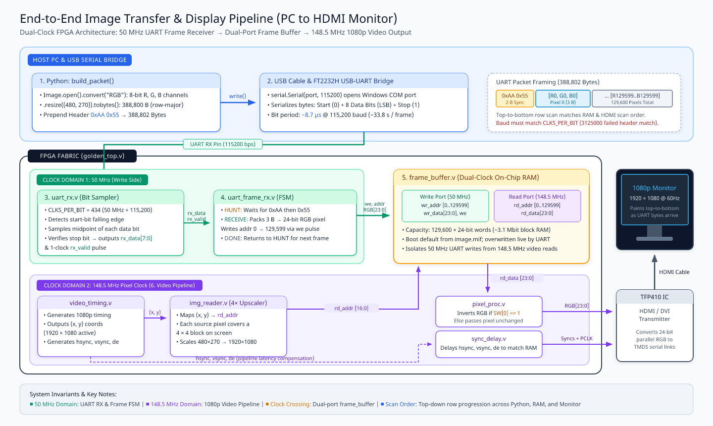

# A3 Real-Time Image Processing

**PC → UART → FPGA frame buffer → real-time pixel processing → HDMI**, built on an Agilex 3 FPGA (Atum A3 Nano, Terasic-style board, device `A3CZ135BB18AE7S`).

This repo is the UART-based milestone of a larger project: make an FPGA sit in the middle of a live video path so that whatever you show on a laptop is captured, sent to the FPGA, processed pixel-by-pixel on the fabric, and displayed on an HDMI monitor — not just passed through, but actually touched by programmable logic on its way to the screen.

> Current stage: a PC sends an image over a serial link, the FPGA stores it in on-chip RAM, inverts every pixel in the video pipeline, upscales it 4×, and drives it out over HDMI at 1080p60. The next stage (not in this repo yet) replaces the serial link with Gigabit Ethernet to get real frame rates.

---

## Table of contents

- [What this actually does](#what-this-actually-does)
- [Pipeline overview](#pipeline-overview)
- [Repository layout](#repository-layout)
- [Hardware](#hardware)
- [Module-by-module guide](#module-by-module-guide)
  - [Top level](#top-level)
  - [HDMI transmitter bring-up (I²C)](#hdmi-transmitter-bring-up-i²c)
  - [Image ingest (UART → frame buffer)](#image-ingest-uart--frame-buffer)
  - [Video output pipeline](#video-output-pipeline)
  - [Utility blocks](#utility-blocks)
- [PC-side uploader](#pc-side-uploader)
- [Clock domains](#clock-domains)
- [Building and running it](#building-and-running-it)
- [Known limitations](#known-limitations)
- [Roadmap](#roadmap)

---

## What this actually does

1. A Python desktop app on a PC loads an image, resizes it to **480×270**, and streams it out over a **USB-serial (UART) link** as a simple framed packet.
2. The FPGA's UART receiver and frame parser write each incoming pixel straight into a **dual-port on-chip RAM frame buffer** (one side clocked by the 50 MHz UART domain, the other by the 148.5 MHz HDMI pixel clock).
3. A **video timing generator** drives a standard 1920×1080p60 HDMI signal. For every displayed pixel it looks up the corresponding stored pixel (with 4× integer upscaling, since the stored image is 4× smaller than the panel in each direction), runs it through a **processing stage** (currently: bitwise invert, toggled by a slide switch), and pushes the result out to an HDMI transmitter chip.
4. A small **I²C master** configures and reads back the ID registers of the HDMI transmitter (TFP410) at power-up so the panel comes up correctly, with no CPU involved — it's a hand-written Verilog I²C state machine.
5. The board also keeps on-screen-free status on four LEDs: UART activity, a 1 Hz heartbeat, PLL lock, and "HDMI transmitter ready."

At power-up, before any PC upload happens, the frame buffer is pre-loaded from an `.mif` file so the board always shows *something* on the monitor.

## Pipeline overview

<p align="center">
  
</p>

<p align="center">
  <b>Figure 1:</b> PC to FPGA Data Processing Pipeline
</p>

See `PC_TO_FPGA_pipeline.png` and `data_flow_diagram.svg` in the repo root for the original hand-drawn versions of this diagram.

## Repository layout

```
.
├── v/                     Verilog source for every FPGA module (see below)
├── sw/                    PC-side software (Python image uploader)
├── ip/                    Quartus-generated IP (PLL, reset-release, etc.)
├── mif/                   Memory-initialization file(s) for the frame buffer
│                          (image.mif — what the board shows before any upload)
├── Test_Images/           Sample images used to exercise the uploader/pipeline
├── qdb/                   Quartus database (synthesis/fitter intermediate files)
├── output_files/          Quartus build outputs (.sof/.pof programming files, reports)
├── dni/                   Quartus project support files
├── tmp-clearbox/          Quartus incremental-compile / clearbox cache (safe to ignore)
├── golden_top.qsf         Quartus project settings: pin assignments, I/O standards,
│                          device selection, file list
├── golden_top.sdc         Timing constraints (clock definitions, false paths)
├── golden_top.qpf / .qws  Quartus project and workspace files
├── golden_top.txt / golden_top_synthesized_save_view.txt
│                          Reports/exports from Quartus (synthesis view, pin-out)
├── PC_TO_FPGA_pipeline.png
├── data_flow_diagram.svg
└── README.md
```

> **Note on `qdb/`, `output_files/`, `tmp-clearbox/`, `golden_top.qws`:** these are Quartus-generated artifacts, not hand-written source. They're useful if you want to reopen the exact project state or grab the last compiled `.sof`, but if you're reading this repo to understand the *design*, everything that matters is in `v/`, `sw/`, `golden_top.qsf`, and `golden_top.sdc`.

## Hardware

| Item | Detail |
|---|---|
| FPGA | Intel/Altera **Agilex 3**, device `A3CZ135BB18AE7S` |
| Board | Atum A3 Nano (Terasic-style dev board) |
| On-chip memory used | M20K blocks, frame buffer sized for 480×270×24-bit (≈ 3.1 Mbit of the board's 6.89 Mbit) |
| Off-chip memory (not yet used) | 64 MB SDRAM, ×32 |
| Display out | HDMI via **TFP410** transmitter, configured over I²C |
| Host link (this stage) | USB-UART via onboard **FT2232H** (shows up as a COM port) |
| Ethernet (not yet used) | Gigabit PHY, **DP83867CR**, RGMII, 1.8 V — reserved for the next project stage |
| User I/O | 2 active-low push buttons (`KEY`), 2 slide switches (`SW`), 4 active-low LEDs (`LED`) |
| Pixel clock | 148.5 MHz, generated by a PLL (`V_PLL` IP) from the 50 MHz board oscillator — standard rate for 1920×1080p60 |

## Module-by-module guide

### Top level

**`golden_top.v`** wires everything together. Reading it top-to-bottom:

- **Power-up reset chain:** `RESET_DELY` debounces/holds `KEY[1]` to produce a clean active-low I²C reset; Intel's `reset_release` IP produces a global `ninit_done` which this design inverts into `reset_n`.
- **TFP410 bring-up:** `HDMI_ISEL` and `HDMI_PD_n` are driven from that reset so the transmitter boots into I²C configuration mode; `TFP410_I2C` then runs the actual I²C transactions.
- **Pixel clock + reset synchronization:** `V_PLL` derives 148.5 MHz from the 50 MHz reference; a 3-flop synchronizer builds `video_rst_n` so the video-domain logic comes out of reset cleanly and synchronously with `pclk` (async assert / sync release — the standard pattern for crossing a reset into a new clock domain).
- **UART ingest path:** `uart_rx` → `uart_frame_rx` → `frame_buffer` (all described below), running in the 50 MHz domain.
- **Activity LED stretcher:** a small free-running counter that holds `rx_activity` high for ~84 ms every time it sees the UART line toggle, so a single short burst of traffic is visible to the eye.
- **Video pipeline:** `video_timing` → `img_reader` → `frame_buffer` (read side) → `pixel_proc` → HDMI output pins, with `sync_delay` keeping `de`/`hs`/`vs` aligned with the pixel data as it moves through those three pipeline stages.
- **LEDs:** UART activity, a 1 Hz heartbeat from `CLOCKMEM`, PLL lock status, and TFP410 "ready," all active-low per the board's LED wiring.

**`image_path_top.v`** is a **self-contained alternative version of the same ingest-to-HDMI path** (UART → frame buffer → 1080p60 timing → output), written as a single module with its own timing counters inline rather than instantiating `video_timing`/`sync_delay`/`img_reader` separately. It's useful as a simpler reference implementation or for swapping into a different top level; it is not instantiated from `golden_top.v` in this version of the design.

### HDMI transmitter bring-up (I²C)

The TFP410 needs to be configured over I²C before it will output a valid signal, and this project does that with a **hand-rolled I²C master built from four cooperating state machines** rather than a vendor IP core — useful to read if you want to understand I²C at the bit level.

- **`TFP410_I2C.v`** is the sequencer: it generates a 400 kHz I²C clock (reusing `CLOCKMEM` as a simple clock divider), then walks through *write the control register → read back vendor ID → read back device ID → done*, driving the three sub-modules below and reporting `READY` once both ID reads succeed.
- **`I2C_WRITE_POINTER.v`** performs an I²C write of a register *pointer* byte (address-within-device), including the repeated-start sequence needed before a following read.
- **`I2C_WRITE.v`** performs a full I²C write transaction (pointer + data byte(s)), used to set the TFP410's control register.
- **`I2C_READ_DATA.v`** performs an I²C read transaction, used to read back the vendor/device ID registers for verification.
- **`CLOCKMEM.v`** is a generic clock divider: it toggles its output every time an internal counter reaches `CLK_FREQ/2`, so dividing a known input frequency by `CLK_FREQ` gives a square wave at `input/CLK_FREQ`. It's reused twice in this design — once to make the 400 kHz I²C clock, once as a 1 Hz heartbeat for the LED.
- **`RESET_DELY.v`** holds a reset output low for a fixed window after power-up (or after `KEY` is pressed), giving the TFP410 and I²C logic time to settle before anything tries to talk to it.

These four I²C modules are plain synchronous state machines clocked by `PT_CK` (the 400 kHz I²C clock) with `RESET_N` as an asynchronous reset — no Quartus I²C IP, no CPU.

### Image ingest (UART → frame buffer)

- **`uart_rx.v`** is a standard 8N1 UART receiver. Baud rate is set purely by the `CLKS_PER_BIT` parameter (clock frequency ÷ baud rate); the input is double-flopped for metastability safety before being sampled, since it's an asynchronous external signal.
- **`uart_frame_rx.v`** sits on top of the raw byte stream and implements the **wire protocol**: wait for the two-byte sync word `0xAA 0x55`, then treat every following group of 3 bytes as one pixel's R, G, B and write it into the frame buffer in raster order, asserting `frame_done` after the last pixel of a 480×270 frame. If a byte is ever dropped mid-frame, the parser doesn't try to resynchronize until the next `0xAA 0x55` — so a dropped byte shifts the rest of that frame, and the *next* upload re-aligns things. (This is the known limitation that Ethernet + sequence numbers is meant to fix.)
- **`frame_buffer.v`** is the dual-port RAM at the center of the design: one 24-bit-wide, 129,600-word (480×270) array, written from the 50 MHz UART domain and read from the 148.5 MHz pixel-clock domain with no explicit handshaking between the two sides (safe here only because this is a single buffer re-read continuously, not a ping-ponged/frame-synchronized design yet — see [Known limitations](#known-limitations)). It's initialized at configuration time from `mif/image.mif` so the board has something to show before any PC upload.

### Video output pipeline

- **`video_timing.v`** generates standard CEA-861 1920×1080p60 timing (2200×1125 total, 1920×1080 active) entirely parametrically — all the standard/front-porch/sync/back-porch widths are module parameters — and outputs registered `de`/`hs`/`vs`/`x`/`y` together, so everything downstream is aligned to one consistent point in time ("t0" in the top-level comments).
- **`img_reader.v`** converts the current `(x, y)` display coordinate into a frame-buffer address, implementing the 4× upscale by right-shifting both coordinates by `SHIFT=2` bits before computing `row * IMG_W + col`. Output is valid one clock after the input coordinate.
- **`pixel_proc.v`** is the actual "processing" stage the whole project is built around. Right now it's deliberately simple: pass the pixel through unchanged, or bitwise-invert every channel (`~pix_in`), selected by the `invert` input (wired to a slide switch, synchronized in `golden_top.v`). This is the module meant to grow — e.g. into thresholding, edge detection, or other point/neighborhood operations — without touching anything else in the pipeline.
- **`sync_delay.v`** is a generic N-stage shift register for an arbitrary-width bus. It's used to delay `de`/`hs`/`vs` by exactly as many clocks as the pixel data takes to pass through `img_reader` → `frame_buffer` → `pixel_proc` (3 stages here), so the control signals and the pixel data arrive at the output pins in lock-step.

### Utility blocks

- **`CLOCKMEM.v`** — see above; a generic clock-division/heartbeat block, instantiated twice.
- **`RESET_DELY.v`** — see above; a generic power-on-reset delay generator.

## PC-side uploader

**`sw/image_uploader.py`** (Tkinter + PySerial + Pillow) is a small desktop GUI:

1. Pick an image file (PNG/JPEG/BMP/GIF).
2. It's resized to exactly 480×270 and converted to raw RGB bytes (`Image.tobytes()`, row-major, R-G-B per pixel).
3. The app prepends the `0xAA 0x55` sync word, picks a COM port and a baud rate (`115200`, `921600`, or `3125000`), and streams the packet out in 4 KB chunks over a serial connection, on a background thread so the GUI stays responsive.
4. A live thumbnail preview and a status line show what's about to be sent and confirm when the send completes.

**Important:** the baud rate selected in the uploader **must match** the `CLKS_PER_BIT` parameter given to `uart_rx` in the FPGA build you've programmed (see [Known limitations](#known-limitations) — this is a common source of "nothing happens" bugs).

## Clock domains

This design deliberately keeps clock-domain crossings to a small, well-understood set:

| Signal | From | To | How it's crossed |
|---|---|---|---|
| `reset_n` → video reset | async (I²C reset chain) | `pclk` (148.5 MHz) | 3-flop synchronizer (`rst_pipe` in `golden_top.v`) |
| `SW[0]` (invert switch) | async (physical switch) | `pclk` | 2-flop synchronizer (`sw_sync`) |
| `uart_rst_n` | async (`KEY[0]`) | 50 MHz UART domain | 3-flop synchronizer (`rst50_pipe`) |
| UART `rx` pin | async (external FT2232H) | 50 MHz | 2-flop synchronizer inside `uart_rx.v` |
| Frame buffer contents | 50 MHz (write side) | 148.5 MHz (read side) | **dual-port RAM only — no frame-boundary handshake yet** |
| 400 kHz I²C clock domain | 50 MHz (derived via `CLOCKMEM`) | — | I²C modules are entirely clocked by the derived 400 kHz clock with async reset |

The one crossing that is *not* yet made safe against tearing is the frame buffer itself — see below.

## Building and running it

1. Open `golden_top.qpf` in **Quartus Prime Pro** (built against 26.1.1; the device requires at least the Agilex 3 support installed).
2. Confirm `golden_top.qsf` points at your installed IP (`V_PLL`, `reset_release`) and that `mif/image.mif` is present and matches the frame buffer's expected format (24-bit words, 129,600 of them).
3. Compile (Analysis & Synthesis → Fitter → Assembler). Expect some benign warnings about I/O assignments and the CDC Design Assistant on the crossings listed above — nothing in this design currently fails timing, but they haven't all been individually waived in `golden_top.sdc` yet.
4. Program the `.sof` from `output_files/` onto the board via USB Blaster III.
5. Connect the board's FT2232H UART port to your PC; note the COM port it enumerates as.
6. Connect HDMI to a monitor — the board should immediately show the image baked into `image.mif`, inverted according to `SW[0]`.
7. Run `sw/image_uploader.py` (`pip install pyserial pillow` first), pick an image, pick the matching COM port and baud rate, and hit Send. The displayed image should update within a few seconds (UART-speed dependent).

## Known limitations

- **Frame rate.** UART, even at the fastest baud offered (3.125 Mbaud), tops out around 1–2 frames/second for a 480×270 RGB image (390 KB/frame). This is fundamentally a bandwidth problem, not a bug — it's why the next stage of this project moves to Gigabit Ethernet.
- **Baud-rate mismatch risk.** The uploader's selected baud rate and the FPGA's compiled-in `CLKS_PER_BIT` must agree; there is currently no auto-negotiation, and sending at the wrong rate looks like "nothing happens" with no error reported on either side.
- **No frame-boundary protection on the frame buffer.** The buffer is written and read continuously from two different clock domains with no handshake; an upload landing mid-scan-out can, in principle, be read half-old/half-new for one frame (tearing). It hasn't been a practical problem at UART speeds and frame rates, but it will need a ping-pong buffer (two frame buffers swapped at vertical blanking) once ingest is fast enough to update many times per second.
- **Mid-frame resync.** `uart_frame_rx` only looks for the `0xAA 0x55` sync word *between* frames; a single dropped byte during a frame shifts everything after it until the next upload restarts synchronization.
- **Outstanding Quartus warnings.** I/O assignment and I/O-delay warnings, and some CDC Design Assistant notices on the synchronizers above, have not all been explicitly reviewed/waived in `golden_top.sdc`.
- **`image_path_top.v` is not wired into `golden_top.v`.** It's a complete, independent version of the same pipeline and can be swapped in, but doing so means removing/bypassing the equivalent logic already in `golden_top.v` rather than using both at once.

## Roadmap

This repo represents the proof-of-concept stage. Planned next steps:

1. **Replace UART with Gigabit Ethernet** (RGMII to the onboard DP83867CR), using a Nios V soft processor running lwIP in RAW mode to receive UDP packets and write them into the frame buffer — enough bandwidth for real-time video instead of ~1–2 fps.
2. **PC-side screen capture**, replacing "load a static image file" with live screen grabbing (e.g. via `mss`), resized and streamed continuously over the new Ethernet link.
3. **Ping-pong frame buffer**, swapping between two buffers at vertical blanking so a fast-arriving new frame never tears the one currently being scanned out to HDMI.
4. **Richer processing in `pixel_proc`** — point operations beyond invert (thresholding, gain/offset) and eventually neighborhood operations (edge detection), which will need line buffers upstream of the single-pixel pipeline this repo currently has.
5. **Formal review of the outstanding timing/CDC warnings**, with explicit `set_false_path`/`set_max_delay` constraints added to `golden_top.sdc` for every intentional asynchronous crossing instead of relying on synchronizer flops alone.
